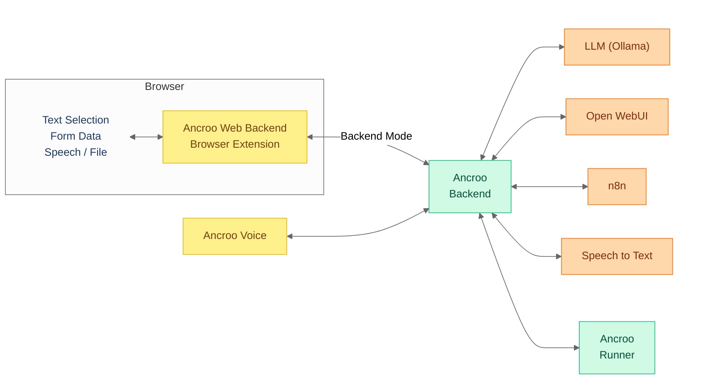

#  Ancroo

**Take routine work off your hands — with AI where it helps.**

Ancroo is the home for projects that start where the work happens — in the browser,
the calendar, the task list — and make everyday processes lighter. AI is a means here,
not the point. It began as a self-hosted AI stack ([now archived](#where-it-started)); today
it holds the projects below, and more will follow.

> **This repo is the umbrella.** It gives the overview and points you to the right
> project — it holds no application code.

---

## Ancroo Web — AI prompts in your browser

**Point. Prompt. Done.** A browser extension: select text or point at a page, run an
AI prompt, and get the result in place — replace the selection, copy it, or show it in
the side panel. Bring your own provider (OpenAI, Anthropic, Gemini, OpenRouter, Ollama
or any OpenAI-compatible endpoint). No server, no account; settings and keys stay in
your browser, and text goes only to the provider you configure.

→ **[Ancroo Web](https://github.com/ancroo/ancroo-web)** ·
[Chrome Web Store](https://chromewebstore.google.com/detail/ancroo/jeaaomlligaaoohplachpimjgopjmfim)

## Ancroo Crew — a team of AI employees

A self-hosted team of AI employees that work together like a company and get better
on the job. Each employee has a task, a personality and limits; they work in your
calendar, task list or notes through MCP services, ask each other for help, and learn
from your corrections. You talk to them in a web UI and chat.

It runs on a Linux server with Docker and uses Claude by Anthropic for every answer —
you need a Claude subscription or an Anthropic API key.

→ **[Ancroo Crew](https://github.com/ancroo/ancroo-crew)**

---

## Where it started

Ancroo began as a self-hosted Docker stack — Ollama, Open WebUI, n8n, speech-to-text —
with a workflow backend, a script runner, a push-to-talk desktop client and a browser
extension, all built to work together. Ancroo Web grew out of that extension.

The stack repositories are **archived**: they stay available, read-only, as reference
code, but receive no updates or fixes.

The stack's last state is **Phase 0 (Beta)**: no encryption, no authentication,
meant for local/trusted networks only. The [Roadmap](ROADMAP.md) describes the
security path that was planned for it and is on hold.

| Project | What it does |
| ------- | ------------ |
| [Ancroo Stack](https://github.com/ancroo/ancroo-stack) | Docker infrastructure and installer — Ollama, Open WebUI, PostgreSQL, n8n, BookStack, STT. |
| [Ancroo Backend](https://github.com/ancroo/ancroo-backend) | Workflow engine connecting the extension to LLMs, STT and n8n; ships example workflows. |
| [Ancroo Runner](https://github.com/ancroo/ancroo-runner) | Deterministic script runner with user-extensible plugins. |
| [Ancroo Voice](https://github.com/ancroo/ancroo-voice) | Desktop push-to-talk STT — hold a key, speak, text appears at the cursor. |
| [Ancroo Web Backend](https://github.com/ancroo/ancroo-web-backend) | Browser extension in backend mode, talking to the stack. Not on the Chrome Web Store. |

---

## Contributing

Feedback is welcome — open an issue in the relevant project, or [here](https://github.com/ancroo/ancroo/issues)
for anything general. The archived repositories are read-only and accept no issues or
pull requests.

## Security

Each active project has its own security policy:
[Ancroo Web](https://github.com/ancroo/ancroo-web/blob/main/SECURITY.md) ·
[Ancroo Crew](https://github.com/ancroo/ancroo-crew/blob/main/SECURITY.md).
[SECURITY.md](SECURITY.md) in this repo covers the archived stack.

## Author

**Stefan Schmidbauer** — [GitHub](https://github.com/Stefan-Schmidbauer) · [stefan@ancroo.com](mailto:stefan@ancroo.com)

## License

MIT — see [LICENSE](LICENSE). The Ancroo name and the anchor logo are not covered by
this license and remain the property of the author. Each project has its own license —
see the individual repositories.

---

Built with the help of AI ([Claude](https://claude.ai) by Anthropic).
